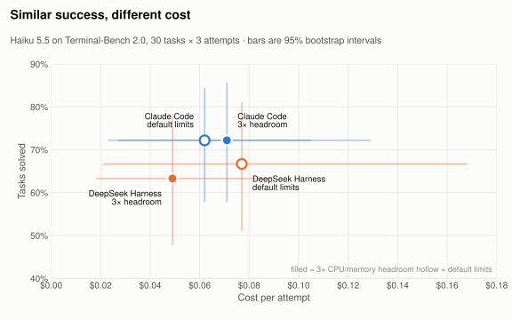
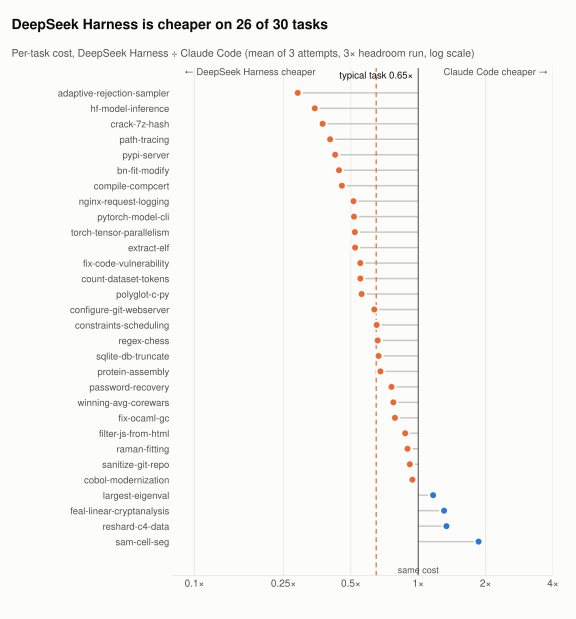
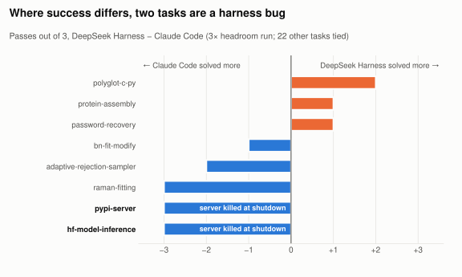
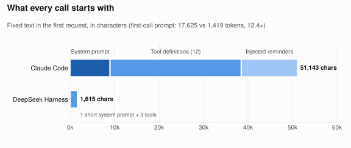

# harness-eval

How much does the harness matter? We held the model fixed (**Claude Haiku 5.5**) and swapped only the harness: **Claude Code** (2.1.316) vs **[DeepSeek Harness](https://github.com/deepseek-ai/deepseek-harness)** (dsh v0.2.1-rc.2, `sdk-minimal` profile: 3 tools, one-line system prompt).

We found that, on a typical Terminal-Bench 2.0 task, Claude Code costs **~1.5×** as much as DeepSeek Harness, with no statistically clear difference in success rate.

<picture>
  <source media="(prefers-color-scheme: dark)" srcset="docs/img/cost-vs-success-dark.svg">
  
</picture>


Much of the gap comes from tokens: Claude Code uses about 60% more tokens per attempt on average, and about 2.5× as many on a typical task. Every call it makes carries a larger system prompt, more tool definitions and about 12.7k characters of system reminders. Most of that repeated text is billed at the cheaper cached-input rate, which is why the cost gap is smaller than the token gap.

<picture>
  <source media="(prefers-color-scheme: dark)" srcset="docs/img/cost-ratio-per-task-dark.svg">
  
</picture>


Other key findings:

1. **Harness design can change benchmark scores.** On two tasks (`pypi-server` and `hf-model-inference`), the verifier marked DeepSeek Harness as failing in every attempt, even though the model appears to have done the work. Both tasks implicitly require starting a background server (a PyPI package server, and a Flask inference API) that keeps running after the agent finishes. When DeepSeek Harness shuts down, it kills every process started from its shell session, so the server is gone before the verifier checks it. Claude Code passed both tasks in every attempt.

<picture>
  <source media="(prefers-color-scheme: dark)" srcset="docs/img/success-diff-per-task-dark.svg">
  
</picture>


2. **Claude Code's first call is >10× larger.** Its first request is 17,625 prompt tokens vs 1,419 for DeepSeek Harness (**12.4×**): 12 tool schemas, a 9k-character system prompt and injected reminders, vs 3 tools and a 46-character system prompt.

<picture>
  <source media="(prefers-color-scheme: dark)" srcset="docs/img/first-call-prompt-dark.svg">
  
</picture>

**Caveats:**
- **"The harness has little effect on success" holds only on average.** Per task, the harness can decide the outcome: `pypi-server` and `hf-model-inference` are 3/3 for Claude Code and 0/3 for DSH in both runs, because dsh's shutdown kills the background server the verifier needs.
- **Mean cost is fragile.** In the first run DSH's *mean* cost was higher ($0.077 vs $0.062), even though it was cheaper on 25/30 tasks, because of two runaway attempts. Use per-task ratios.
- **Infrastructure moves results.** DSH's 6 timeouts and out-of-memory kills disappeared with 3× headroom.

**Not tested here:** SWE-bench Lite, Codex or Pi, other models, or [HarnessTax](https://arena.ai/blog/coding-agents-harness-tax)'s "up to 5×" cost spread.

## Results

Terminal-Bench 2.0, 30 random tasks × 3 attempts, 100-turn cap, local Docker on Apple Silicon, one frozen price list. We ran each harness twice: once with the task's default resource limits, and once with 3× CPU and memory headroom ("x3"). Following HarnessTax, results are averaged per task, with 95% intervals from a 10,000-resample task bootstrap.

| Haiku 5.5 | Success [95% CI] | Cost / attempt | Tokens / attempt |
|---|---|---|---|
| Claude Code | 72.2% [57.8, 84.4] | $0.062 | 0.93 M |
| Claude Code, x3 | 72.2% [57.8, 85.6] | $0.071 | 1.13 M |
| DeepSeek Harness | 66.7% [51.1, 81.1] | $0.077 | 0.94 M |
| DeepSeek Harness, x3 | 63.3% [47.8, 77.8] | $0.049 | 0.69 M |

Paired, x3 (DSH vs CC): cost ratio **0.65× [0.56, 0.76]**, token ratio **0.40×**, success **−8.9 pts [−22.2, +3.3]**.

Raw run data (trajectories, logs, write-ups) is not in this repository.

## Run it

Needs Docker (≥32 GB memory for the VM; Rosetta on, since task images are amd64) and [uv](https://docs.astral.sh/uv/).

```bash
uv sync && cp .env.example .env            # then set ANTHROPIC_API_KEY in .env
uv run hx run tb2-cc-haiku55-x3 --mock --tasks fix-git --attempts 1   # free pipeline check
uv run hx run tb2-cc-haiku55-x3 && uv run hx run tb2-dsh-haiku55-x3
uv run hx compare tb2-cc-haiku55-x3 tb2-dsh-haiku55-x3
uv run hx langfuse up && uv run hx ingest tb2-cc-haiku55-x3     # browse traces at localhost:3000
```

Experiments are YAML files in `experiments/`, prices are in `pricing/`, and the DSH adapter is `src/harness_eval/agents/deepseek_harness.py`. `uv run hx --help` lists every command.
